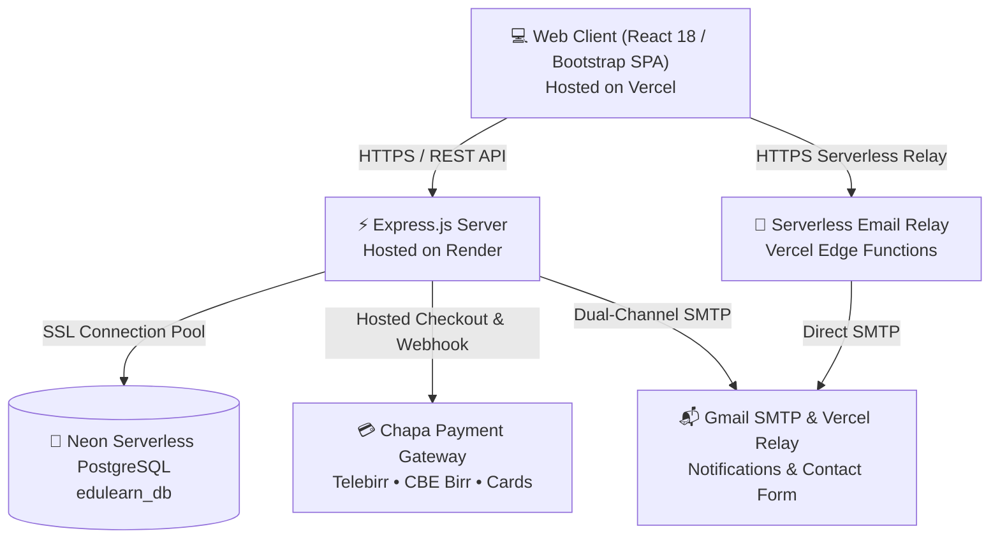

# 🎓 EduLearn — Modern Full-Stack E-Learning & Assessment Platform

[](https://e-learning-three-phi.vercel.app)
[](https://e-leraning.onrender.com/api/health)
[](https://neon.tech)
[](https://chapa.co)
[-brightgreen?style=for-the-badge&logo=checkmarx)]()
[](LICENSE)

> A modern, full-stack educational technology platform engineered to deliver interactive courses, gated video lessons, dynamic assessments, and automated certification with seamless Ethiopian Birr (ETB) payments.

---

## 🌐 Live Deployments

* **Web Application (Frontend SPA)**: [https://e-learning-three-phi.vercel.app](https://e-learning-three-phi.vercel.app)
* **REST API Service (Backend)**: [https://e-leraning.onrender.com](https://e-leraning.onrender.com)
* **API Health Check**: [https://e-leraning.onrender.com/api/health](https://e-leraning.onrender.com/api/health)
* **Database**: Serverless PostgreSQL on **Neon.tech** (AWS eu-central-1)

---

## 🏗️ System Architecture

EduLearn is architected as a high-availability, decoupled client-server platform optimized for low latency, robust data persistence, and bank-grade payment processing:



---

## ✨ Key Features & Capabilities

### 👨‍🎓 For Students / Learners
* **Course Catalog & Discovery**: Real-time keyword search, category filters, and difficulty level tags.
* **Free Lesson Previews**: Stream introductory course lessons without requiring up-front registration.
* **Chapa Multi-Payment Gateway**: Pay in Ethiopian Birr (`ETB`) with instant activation via **Telebirr**, **CBE Birr**, **Awash / BOA / Dashen**, or **Local Debit Cards**.
* **Collision-Free Reconciliation**: Real-time payment verification polling and server-side transaction logging.
* **Curriculum Progress Tracking**: Interactive video lesson player with step-by-step progress tracking and completion markers.
* **Interactive Quizzes**: Timed assessments with automated scoring, question randomized orders, and instant feedback.
* **Personalized Dashboard**: Track enrolled courses, completion percentages, quiz scores, and verified certificates.

### 👩‍🏫 For Instructors / Teachers
* **Instructor Onboarding**: Role-based instructor application pipeline with administrative review.
* **Course Creator**: Comprehensive curriculum management (modules, lessons, video URLs, resources, and free preview flags).
* **Assessment Builder**: Create quizzes with customizable multiple-choice questions, point weightings, and passing thresholds.
* **Student Roster & Insights**: View enrolled learners and track individual student performance.

### 🛡️ For Administrators
* **Centralized Dashboard**: Real-time metrics on total students, active instructors, revenue, and platform courses.
* **User & Role Management**: Manage user roles (`student`, `teacher`, `admin`) and activate pending instructor applications.
* **Financial Auditing**: Inspect all transaction references (`tx_ref`), payment statuses, and gateway logs.
* **Platform Security**: Role-Based Access Control (RBAC) preventing unauthorized endpoint access.

### 📩 Contact & Help Center
* **Interactive FAQ System**: Instant accordion search across course policies, payments, and account questions.
* **Direct Contact Relay**: Contact form with visitor auto-acknowledgment and dynamic sender labeling (`"${name} (via EduLearn)"`) preventing inbox clutter and email bounce errors.

---

## 🛠️ Technology Stack

| Domain | Technology | Description |
| :--- | :--- | :--- |
| **Frontend** | React 18, Vite | High-performance SPA with fast compilation and optimized chunk splitting |
| **Styling & UI** | Bootstrap 5, Lucide Icons, FontAwesome | Responsive mobile-first design with accessible UI components |
| **Routing** | React Router v6 | Client-side routing with role-based route guards and redirect handling |
| **Backend** | Node.js, Express.js | Modular RESTful API with async controller architecture |
| **Database** | PostgreSQL (`pg`, `pg-pool`) | Serverless database hosted on **Neon** with SSL and auto-scaling |
| **Security** | Helmet, bcryptjs, jsonwebtoken, CORS | OWASP Top 10 mitigation, password hashing, and HMAC JWT tokens |
| **Rate Limiting**| express-rate-limit | Brute-force protection with payment polling exemptions |
| **Validation** | express-validator | Strict perimeter input sanitization for SQLi and XSS defense |
| **Payments** | Chapa API | Ethiopian Birr payment orchestration with hosted checkout and webhooks |
| **Email Delivery**| Nodemailer + Vercel HTTPS Relay | Dual-channel email system with test domain bounce suppression |
| **Hosting** | Vercel (Frontend) + Render (Backend) | Production deployment pipeline with continuous integration |

---

## 📁 Repository Structure

```text
E-learning/
├── Backend/                       # Express.js REST API Server
│   ├── config/                    # Database pool, Passport, and OAuth configurations
│   ├── controllers/               # Business logic (Auth, Courses, Lessons, Payments, etc.)
│   ├── database/                  # PostgreSQL migrations, schema DDL, and seed scripts
│   ├── middleware/                # Auth guard, RBAC, input validation, and rate limiters
│   ├── models/                    # Data Access Objects (DAO) interfacing Neon PostgreSQL
│   ├── routes/                    # API route declarations
│   ├── scripts/                   # Automated QA test harnesses and database migrations
│   │   └── run-qa-suite.cjs       # 34-case automated ISTQB & OWASP test runner
│   ├── services/                  # External integrations (Chapa API, Email Service)
│   ├── utils/                     # Cryptography, JWT helpers, and HTTP response utilities
│   ├── app.js                     # Express app setup and middleware pipeline
│   └── server.js                  # Server initialization and port binding
├── frontend/                      # React 18 + Vite SPA
│   ├── react-app/                 # Application source code
│   │   ├── src/
│   │   │   ├── components/        # Reusable UI elements (Navbar, Footer, ProtectedRoute, etc.)
│   │   │   ├── context/           # React Context providers (AuthContext)
│   │   │   ├── pages/             # Page views (Home, Courses, CourseDetail, Dashboard, Payment, etc.)
│   │   │   ├── services/          # API client and HTTP request helpers
│   │   │   └── utils/             # Formatters, currency converters, and validators
│   │   ├── public/                # Static assets, branding, and icons
│   │   └── index.html             # HTML5 template
│   ├── package.json               # Frontend dependencies & Vite scripts
│   └── vite.config.js             # Vite build configuration
├── api/                           # Vercel Serverless Edge Functions
│   └── send-email.js              # HTTPS serverless email relay (bypasses cloud SMTP blocks)
├── vercel.json                    # Vercel deployment routing and SPA rewrites
└── README.md                      # Platform documentation
```

---

## 🚀 Getting Started & Local Development

### Prerequisites
* **Node.js**: v18.0.0 or higher
* **npm**: v9.0.0 or higher
* **PostgreSQL Database**: Local PostgreSQL or a free [Neon](https://neon.tech) cloud database

---

### Step 1: Clone the Repository
```bash
git clone https://github.com/Yerosan-Girma/E-learning.git
cd E-learning
```

---

### Step 2: Configure Backend Environment
Navigate into the `Backend` directory and configure `.env`:
```bash
cd Backend
npm install
```

Create a `.env` file inside `Backend/`:
```env
PORT=5000
NODE_ENV=development

# Database (Neon PostgreSQL connection string with SSL)
DATABASE_URL=postgresql://<user>:<password>@<host>/<database>?sslmode=require

# JWT & Authentication
JWT_SECRET=your_super_secret_jwt_key_here
JWT_EXPIRES_IN=7d
SESSION_SECRET=your_session_secret_key

# CORS Settings
CORS_ORIGIN=http://localhost:5173,https://e-learning-three-phi.vercel.app

# Chapa Payment Gateway (ETB)
PAYMENT_GATEWAY_MODE=chapa
CHAPA_BASE_URL=https://api.chapa.global
CHAPA_PUBLIC_KEY=CHAPA_TEST_PUB_xxxxxxx
CHAPA_SECRET_KEY=CHAPA_TEST_PRIV_xxxxxxx
CHAPA_WEBHOOK_SECRET=your_webhook_secret

# Email Delivery (Gmail SMTP or Relay)
SMTP_HOST=smtp.gmail.com
SMTP_PORT=587
SMTP_SECURE=false
SMTP_USER=your_email@gmail.com
SMTP_PASS=your_gmail_app_password
EMAIL_FROM="EduLearn Platform <your_email@gmail.com>"
ADMIN_CONTACT_EMAIL=your_email@gmail.com
```

---

### Step 3: Configure Frontend Environment
In a separate terminal, navigate to the frontend directory:
```bash
cd frontend
npm install
```

Create a `.env` file inside `frontend/react-app/`:
```env
VITE_API_BASE_URL=http://localhost:5000/api
```

---

### Step 4: Run Development Servers

**Start Backend Server** (Port `5000`):
```bash
cd Backend
npm run dev
```

**Start Frontend Application** (Port `5173`):
```bash
cd frontend
npm run dev
```

Open your browser at `http://localhost:5173` to explore the platform.

---

## 🧪 Automated Testing & QA Suite

EduLearn includes an automated quality assurance test harness ([`run-qa-suite.cjs`](file:///Backend/scripts/run-qa-suite.cjs)) testing against the live database, payment endpoints, and security layers.

### Run Full Test Suite:
```bash
node Backend/scripts/run-qa-suite.cjs
```

### Test Execution Results (100% Pass Rate):
```text
===============================================================
📊 EXECUTION SUMMARY: 34/34 PASSED (100.0%)
   Passed: 34 | Failed: 0 | Blocked: 0
===============================================================
```

| Test Level | Total Cases | Passed | Status | Coverage |
| :--- | :---: | :---: | :---: | :--- |
| **Level 1: Unit Tests** | 7 | 7 | 🟢 PASS | Unique `tx_ref` concurrency, ETB rounding, JWT signing, quiz scoring |
| **Level 2: Integration & API** | 17 | 17 | 🟢 PASS | Neon DB pool, Auth register/login, catalog search, preview gating, Chapa init |
| **Level 3: Security & OWASP** | 8 | 8 | 🟢 PASS | Zero secret leaks, SQLi defense, RBAC protection, tamper detection |
| **Level 4: Performance** | 2 | 2 | 🟢 PASS | Production bundle integrity, API average latency < 250 ms |

---

## 📡 Core API Reference

| Method | Endpoint | Access | Description |
| :--- | :--- | :--- | :--- |
| `GET` | `/api/health` | Public | Server uptime and status check |
| `POST` | `/api/auth/register` | Public | Student and instructor registration |
| `POST` | `/api/auth/login` | Public | User authentication; returns JWT session token |
| `GET` | `/api/auth/me` | Authenticated | Fetch current authenticated user profile |
| `GET` | `/api/courses` | Public | Browse course catalog with search and filters |
| `GET` | `/api/courses/:id` | Public | Retrieve syllabus, lessons, and enrollment status |
| `GET` | `/api/lessons/:id` | Conditional | Stream lesson video (free previews or enrolled access) |
| `POST` | `/api/payments/courses/:id/initialize` | Authenticated | Generate Chapa hosted checkout URL and unique `tx_ref` |
| `POST` | `/api/payments/chapa/verify` | Authenticated | Verify Chapa transaction status and unlock course |
| `POST` | `/api/payments/chapa/webhook` | Chapa Server | Server-to-server webhook confirmation |
| `GET` | `/api/dashboard/student` | Student | Enrolled courses, completion rates, and statistics |
| `GET` | `/api/dashboard/admin` | Admin | System overview, revenue, users, and audit logs |
| `POST` | `/api/contact` | Public | Submit visitor inquiries with auto-acknowledgment |

---

## 🔒 Security Best Practices Implemented

* **SQL Injection Immunity**: 100% of database interactions utilize parameterized queries (`$1`, `$2`), preventing SQL injection attacks.
* **Defense-in-Depth Validation**: All request bodies pass through `express-validator` at the perimeter layer before hitting controllers.
* **Cryptographic Password Protection**: User passwords are encrypted with one-way salted `bcryptjs` (Cost factor 10).
* **Role-Based Access Control (RBAC)**: Protected endpoints enforce role authorization, prohibiting privilege escalation.
* **Secret Leakage Elimination**: Responses are filtered to prevent leaking hashes, API keys, or private tokens.
* **Intelligent Email Bounce Prevention**: Suppresses email dispatch for test domains (`.test`, `.example`), protecting SMTP reputation.

---

## 📄 License

This project is open-source and available under the [MIT License](LICENSE).

---

## 👨‍💻 Author & Maintainer

**Yerosan Girma**  
* GitHub: [@Yerosan-Girma](https://github.com/Yerosan-Girma)  
* Project Repository: [https://github.com/Yerosan-Girma/E-learning](https://github.com/Yerosan-Girma/E-learning)
